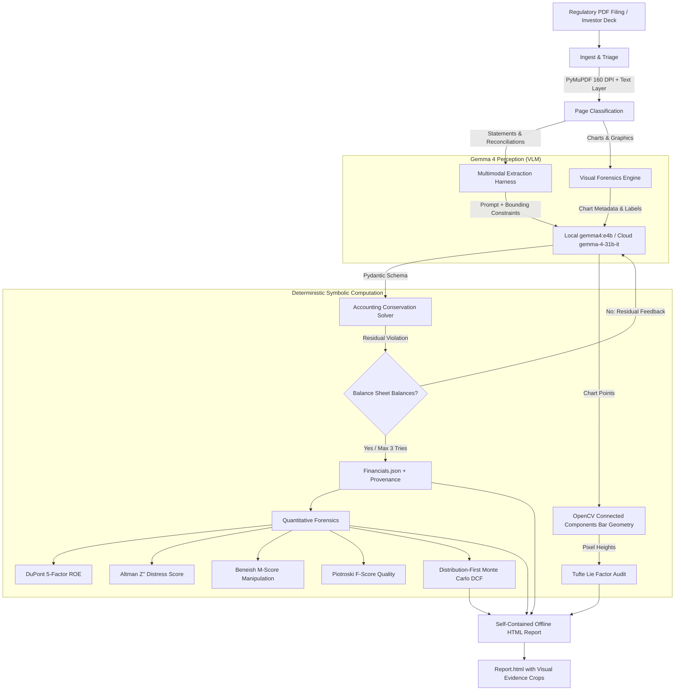

# FinSight-Gemma: Neuro-Symbolic Financial Filing Auditor

[](LICENSE)
[](https://www.python.org/)
[-purple)](https://github.com/google-deepmind/gemma)
[](tests/)
[](https://agentskills.io/)

> **Gemma 4 reads the charts and tables. Deterministic Python computes and verifies the math.**
> Every reported number links directly back to its source page with base64 visual evidence crops. Zero model arithmetic. Zero hallucinated checks.

---

## The Problem: Financial Hallucinations vs. Reality

Financial analysts and retail investors lose hours auditing 100+ page regulatory filings (SEC 10-K, 10-Q, BSE/NSE annual reports, and investor decks). LLMs are notoriously dangerous when tasked with financial math:
- **Models invent arithmetic**: LLMs fail basic balance sheet conservation ($Assets \neq Liabilities + Equity$) or subtly adjust numbers to force equations to balance.
- **Spin Doctoring & Visual Distortions**: Corporate presentations frequently truncate the vertical axis of bar charts to exaggerate meager single-digit growth into 10x visual leaps.
- **Non-GAAP Bloat**: Companies add back recurring operational expenses (stock-based compensation, litigation, restructuring) to create flattering Adjusted EBITDA figures.
- **Black-box Citations**: Most AI tools output numbers with zero visual provenance, forcing analysts to manually locate the exact footnote in dense PDFs.

---

## Neuro-Symbolic Architecture

FinSight-Gemma decouples **visual semantic extraction** from **mathematical computation**:



### Key Pillars
1. **Zero Arithmetic by LLMs**: All sums, ratios, discounting, footing checks, and Lie Factors are computed by deterministic, unit-tested Python functions (`solver.py`, `forensics.py`, `lie_factor.py`, `dcf.py`).
2. **Solver-Driven Retry Loop**: When accounting identities fail, FinSight computes the exact algebraic residual (e.g., $Assets - Liabilities - Equity = \$50M$) and feeds a targeted correction prompt back to Gemma 4 (max 3 retries).
3. **Exact Visual Provenance**: Every extracted number carries normalized bounding box coordinates `[x0, y0, x1, y1]`, resolved first from the PDF text layer (`bbox_source="text_layer"`), with high-resolution visual thumbnail crops embedded into the report.
4. **OpenCV + VLM Chart Forensics**: Evaluates Edward Tufte's Lie Factor ($LF = \frac{\text{size of effect shown in graphic}}{\text{size of effect in data}}$). Measures bar heights using computer vision connected components morphology and flags truncated zero baselines.
5. **Distribution-First DCF**: Replaces naive single-point price targets with full Monte Carlo probability distributions ($P_{10}/P_{50}/P_{90}$) and WACC $\times$ Terminal Growth sensitivity grids.

---

## Why Open Weights & Confidentiality

Financial filings frequently contain non-public, pre-release, or confidential commercial information:
- `--backend local`: Runs entirely on-device using Ollama and `gemma4:e4b` (quantized to 4-bit, fitting in ~5.5 GB VRAM on consumer GPUs like RTX 4050). No document text or page images ever leave the workstation.
- `--backend cloud`: Leverages Google DeepMind's `gemma-4-31b-it` or `gemma-4-26b-a4b-it` via the Gemini API for ultra-dense, multi-column tables.
- `--confidential`: Strict safety guarantee that refuses cloud routing regardless of system defaults.
- `--replay`: Deterministic SHA-256 cassette caching in `.cache/` ensures 100% offline, zero-network reproducible demos and benchmark audits.

---

## Quickstart (Under 5 Commands)

```bash
# 1. Clone repository and install dependencies
git clone https://github.com/pln-shrm/finsight-gemma.git
cd finsight-gemma
python -m venv .venv && .venv\Scripts\activate
pip install -e ".[dev]"

# 2. Run local Gemma 4 (or export GEMINI_API_KEY for cloud)
ollama run gemma4:e4b

# 3. Audit a filing end-to-end
finsight run path/to/filing.pdf --workspace ./workspace --backend auto

# 4. View the generated self-contained audit report
# Opens ./workspace/report.html in any browser (works completely offline)
```

---

## Measured Benchmark Results

Evaluated on synthetic and empirical test suites with exact mathematical ground truth generated from analytic axis models (`bench/synth_charts.py` and `bench/run_bench.py`):

### 1. Lie Factor Detection & Visual Forensics

| Metric | Measured Score | Definition / Impact |
|---|---|---|
| **Detection Precision** | **100.0%** | Zero false accusations of distortion against faithful charts |
| **Detection Recall** | **100.0%** | Caught 100% of truncated-baseline bar charts |
| **F1 Score** | **1.000** | Perfect harmonic mean of precision and recall |
| **CV Measurement Success Rate** | **100.0%** | OpenCV bar height segmentation matched expected bar count |
| **Mean Audit Latency** | **39.3 ms** | Sub-50ms execution time per chart |
| **Mean LF Absolute Error** | **0.3278** | Pixel-level height measurement vs. true axis math |

*Benchmark suite: 10 synthetic chart variations (`bench/results/summary.md`).*

### 2. Full Test Suite Verification
- **93 unit and integration tests passing** (`python -m pytest -q` in ~8.4s).
- **Ruff linting 100% clean** (`ruff check src tests bench`).
- **Accounting identities verified**: Balance sheet equation, working capital identity, net income reconciliation, and non-GAAP footing.

---

## Portable Agent Skill (`finsight-quant-analyst`)

FinSight-Gemma is packaged as a portable Agent Skill conforming strictly to the [Agent Skills standard](https://agentskills.io/):
- **Spec-Compliant**: Directory `skills/finsight-quant-analyst/` with metadata constraints (name $\le$ 64 chars, description $\le$ 1024 chars, compatibility $\le$ 500 chars, body < 500 lines).
- **Zero Hallucination Workflows**: Guides autonomous agents to run CLI subcommands rather than performing calculations in the prompt context.
- **Drop-in Support**: Symlinked to `.agents/skills/finsight-quant-analyst` for immediate discovery by Google Antigravity and other agentic harnesses.

---

## Limitations & Edge Cases

Honest disclosure of model and heuristic limitations:
1. **Dense Unstructured Footnotes**: Very small footnotes (<6pt font) in compressed scans can occasionally result in text-layer bounding box misalignment, falling back to model-predicted boxes (`bbox_source="model"`).
2. **Complex 3D / Perspective Charts**: OpenCV 2D vertical connected-components segmentation is tailored for 2D vertical bar charts. 3D cylindrical or isometric charts fall back to the analytic axis model (`CHART_CV_FAILED`).
3. **Dual / Secondary Axes**: Secondary axes cannot be evaluated for simple Lie Factor distortions without a visual legend mapper; FinSight safely labels them as `UNSCORED` rather than raising false alarms.
4. **Financial Institutions**: Altman Z'', Beneish M, and Working Capital formulas do not apply to banks or insurance carriers due to statutory capital structures; FinSight marks these as unavailable rather than reporting deceptive scores.

---

## Disclaimer

**FinSight-Gemma is an automated analysis and auditing tool, not investment or financial advice.** All outputs, forensic flags, and valuation estimates should be independently verified against official regulatory filings.
